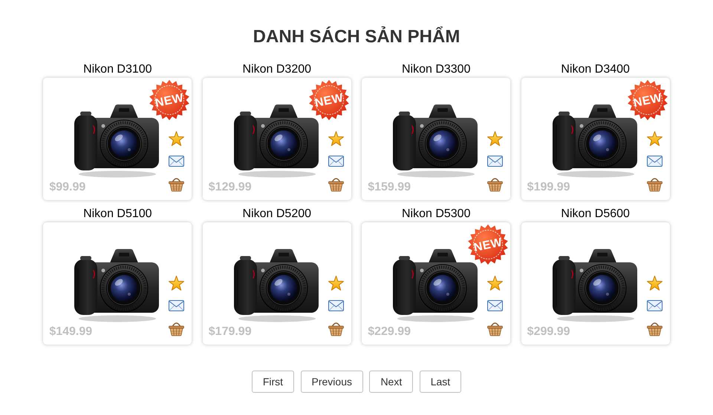

# Bài 2.2 – CSS box model: trang danh sách sản phẩm

Bài tập CSS trong sách *Bài tập Thiết kế Web*, mục **2.2. CSS box model** (Hình 2.9 và 2.10).

## Kết quả



## Yêu cầu

Thiết kế trang sản phẩm dạng danh sách hàng ngang, mọi sản phẩm có bố cục giống nhau. Mỗi sản phẩm gồm:

| Class | Thành phần | Vị trí |
|---|---|---|
| `.hh-box` | hộp chứa sản phẩm | `position: relative`, xếp hàng ngang bằng `inline-block` |
| `.hh-box-name` | tên sản phẩm | trên đỉnh hộp (`top: -20px`) |
| `.hh-box-image` | ảnh sản phẩm | giữa hộp, 130×130px |
| `.hh-box-icon` | biểu tượng NEW | góc trên bên phải |
| `.hh-box-price` | giá | góc dưới bên trái |
| `.hh-box-actions` | Yêu thích / Gửi mail / Giỏ hàng | góc dưới bên phải |

Bên dưới danh sách có các nút phân trang *First, Previous, Next, Last*.

## Cấu trúc

```
css-box-model-san-pham/
├── index.html          # 8 sản phẩm + phân trang
├── style.css
├── images/
│   ├── product.png     # ảnh máy ảnh
│   ├── new-icon.png    # biểu tượng NEW
│   ├── Favourites.png  # icon yêu thích
│   ├── Letter.png      # icon gửi mail
│   └── Basket.png      # icon giỏ hàng
└── screenshot.png      # ảnh kết quả
```

Ảnh máy ảnh và các icon được vẽ bằng SVG rồi xuất ra PNG, đặt tên đúng như mã HTML trong sách.

## Kiến thức CSS sử dụng

- **Box model:** `margin`, `padding`, `width`, `border-radius`, `box-shadow`
- `display: inline-block` để các hộp nằm cạnh nhau và tự xuống hàng khi hết chỗ
- `position: relative` (hộp cha) kết hợp `position: absolute` (tên, giá, icon, nút) để đặt phần tử vào các góc của hộp
- `width: inherit`: tên sản phẩm rộng bằng hộp chứa
- `:hover`: đổi bóng hộp sang màu đỏ khi rê chuột
- Bộ chọn con cháu `.hh-box-actions img`

## Cách chạy

Tải repo về (**Code → Download ZIP**) rồi mở file `index.html` bằng trình duyệt (giữ nguyên thư mục `images`).
